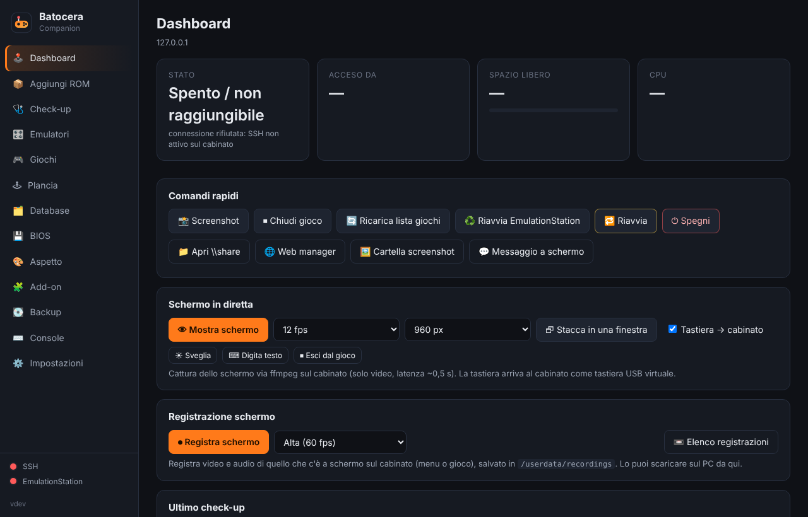
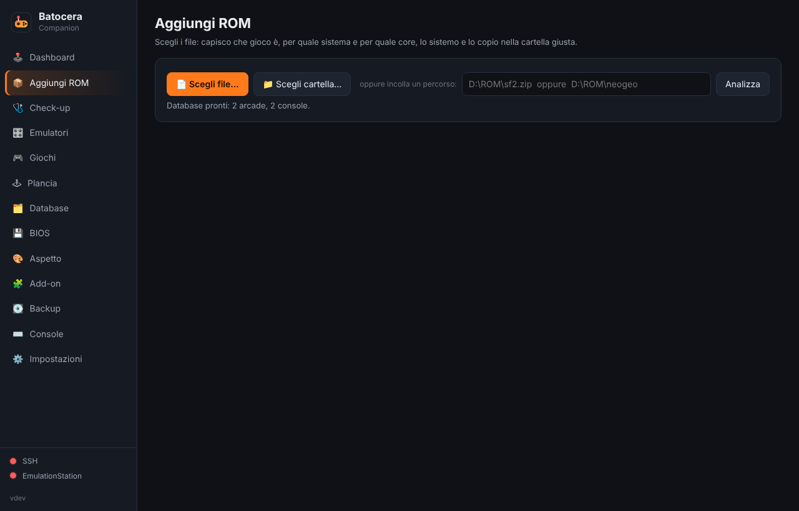
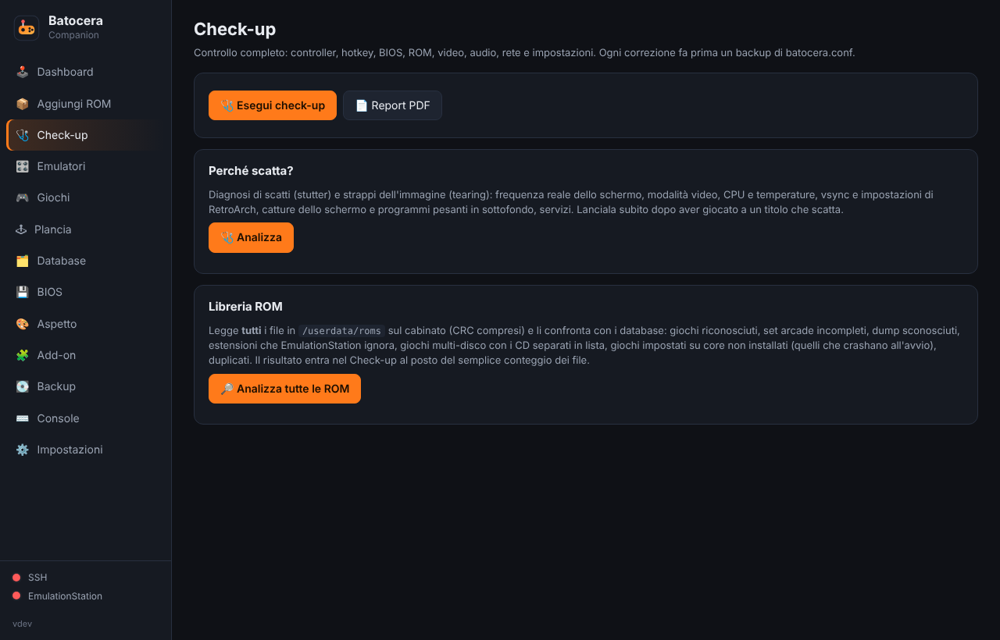
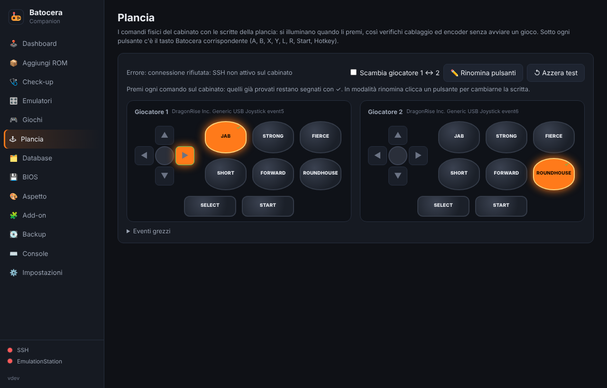
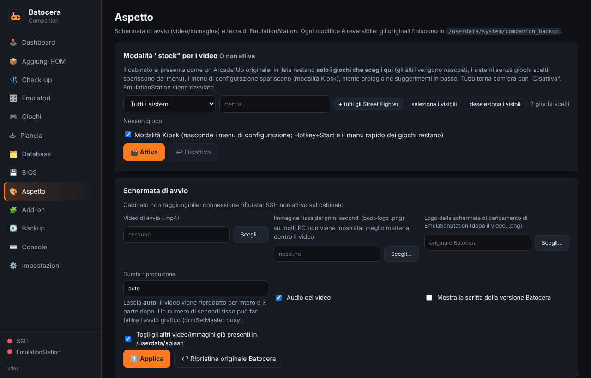

# Batocera Companion

App Windows (e server opzionale sul cabinato) per gestire da un PC un cabinato arcade con **Batocera Linux** — nata per un Arcade1Up *Street Fighter Legacy* moddato con un mini PC, ma funziona con qualsiasi installazione Batocera x86_64 raggiungibile via SSH.

Tutto passa da SSH + l'API HTTP di EmulationStation: niente da installare sul cabinato (il server sul cabinato è facoltativo, serve per usare l'app dal telefono a PC spento).



## Cosa fa

- **Aggiungi ROM** — scegli file o cartelle sul PC: riconosce gioco e sistema (DAT No-Intro/Redump/FBNeo/MAME, intestazioni dei file), verifica e **ricostruisce i set arcade** dai CRC (anche da zip con nomi sbagliati o da parent/merged set), sceglie il core in base alle tue preferenze, converte in CHD, copia nella cartella giusta e rigenera la lista giochi. Copia e analisi girano in parallelo.
- **Giochi** — elenco da EmulationStation, avvio, scheda con metadati e grafiche (caricamento manuale), scraper libretro-thumbnails o ScreenScraper, nomi puliti, multi-disco (.m3u), cestino, conversione dei set alla versione di MAME installata.
- **Check-up** — controller, hotkey, BIOS, ROM, video (60 Hz!), audio, rete, prestazioni, con correzioni a un clic e backup automatico di batocera.conf. "Perché scatta?" diagnostica stutter e tearing. Analisi completa della libreria ROM. Report PDF.
- **Emulatori** — impostazioni per sistema spiegate, con valori consigliati per la CPU del cabinato.
- **Aspetto** — video/logo di avvio, temi, modalità **"stock"** per i video (restano visibili solo i giochi scelti, menu in Kiosk).
- **Add-on** — store Batocera, Batocera Unofficial Add-Ons, Flathub; configurazione con un clic di **Steam** (avvio dalla sezione Steam con la plancia, hotkey+start per uscire) e **Chiaki** (PS5 Remote Play persistente).
- **Dashboard** — stato, schermo in diretta (kmsgrab, cursore, tastiera e pad virtuale dal telefono), registrazione video, screenshot, appunti PC↔cabinato, console SSH multi-riga.
- **Plancia** — i comandi fisici con le scritte della plancia che si illuminano quando li premi.
- **Backup** — incrementale sul PC o su un disco USB collegato al cabinato (rsync), con ripristino.
- **Impostazioni** — server sul cabinato con PIN (web app per iPhone, link per Home Assistant), agente Home Assistant (MQTT), pulsanti volume, plancia→tastiera per gli emulatori Wine, Tailscale, ScreenScraper, lightgun Sinden, promemoria aggiornamenti.

| | |
|---|---|
|  |  |
|  |  |

## Installazione

Scarica l'ultimo `BatoceraCompanion-Setup-x.y.z.zip` dalle release, estrai e lancia l'installer. Al primo avvio inserisci IP e password SSH del cabinato (di serie `root` / `linux`).

Dal telefono: Impostazioni → *Server sul cabinato* → Installa; poi apri `http://IP-del-cabinato:8765` e inserisci il PIN.

## Build

Richiede Go 1.24+, NSIS (`makensis`) e `zip`:

```
./build.sh
```

Genera il server Linux per il cabinato, l'exe Windows, l'installer e lo zip in `dist/`. `testenv/` contiene un cabinato Batocera simulato (sshd + API di EmulationStation finta) usato per i test.

## Licenza

MIT — vedi `LICENSE`. ScreenScraper richiede credenziali sviluppatore proprie (si richiedono sul loro forum); questo programma non ne include.
